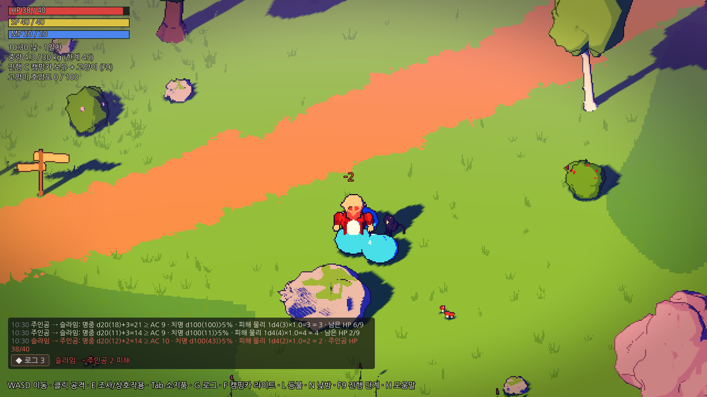

# Denial — P1 코어 플레이 프로토타입

힐링 판타지 RPG(가칭, Godot 프로젝트명 **Denial**)의 Godot 프로젝트입니다. P0(고정 탑다운 + 3D 픽셀화 렌더,
데드셀풍 D 스타일) 위에 **P1 코어 플레이 루프**를 올렸습니다: 야외 지역 1곳에서 전투 → 시체 조사 → 중량 인벤토리 →
캠핑카 운전·실내·창고·수면 → 사망/복귀 → 검은 고양이 동행·교감. 기획 기준은 [`docs/GDD.md`](docs/GDD.md) **v10.2**와
[`docs/CAT_COMPANION_HANDOFF.md`](docs/CAT_COMPANION_HANDOFF.md)이며, 미정 사항을 임시로 정한 값은
[`notes/IMPLEMENTATION_ASSUMPTIONS.md`](notes/IMPLEMENTATION_ASSUMPTIONS.md)에 모두 적었습니다(정식 규칙 아님).



> **주인공 모델:** 사용자가 준 AI 생성 모델(Tripo)을 뼈대에 붙여 사용 (걷기·공격·사용 동작, 장비, 스프라이트) → [`notes/PLAYER_MODEL.md`](notes/PLAYER_MODEL.md)

> **대화 에디터:** Godot 에디터 위쪽 `Dialogue` 탭에서 대사·선택지·조건·퀘스트 액션·컷씬 호출을 노드로 작성하고
> 미리보기·검증·저장·게임에서 실행까지 할 수 있습니다 → [`notes/DIALOGUE_EDITOR.md`](notes/DIALOGUE_EDITOR.md)

## P1에서 해 볼 수 있는 것

| 흐름 | 방법 |
|---|---|
| 전투 | 마우스 방향 클릭 1회 = 1회 공격(SP 4). 무기 영역이 닿아야 판정 → d20 명중 → 별도 치명 굴림 → 1d4 피해. 풀밭 슬라임(캠프 동쪽, 비선공)·숲 슬라임(북동쪽 숲, 선공). 한 마리를 치면 근처 같은 종이 합류 |
| 전투 로그 | 좌하단. `G`(또는 클릭)로 1 아이콘 → 2 한 줄 → 3 상세(주사위·계산식) |
| 시체 조사 | 처치한 자리의 시체 앞에서 `E` → 원하는 것만 "가져가기"/"모두"/"전부 가져가기". 게임 시간 60분 뒤 사라짐 |
| 중량 | `Tab` 소지품(게임은 계속 진행). 30kg 초과 시 느려지고 45kg을 넘기는 획득은 거부. 캠프의 **보급 상자**(철광석)로 시험 |
| 캠핑카 | 문 앞 `E` 실내, 운전석(앞바퀴 옆) `E` 운전: **차 머리 기준: `W` 전진, `S` 브레이크→후진, `A`/`D` 머리 좌/우**(키를 놓으면 정지), 멈춘 뒤 `E` 하차. `F` 외부 라이트 ([운전 조작 개선](notes/DRIVING.md)) |
| 실내 | 문 매트 `E` 밖으로, 오른쪽 아래 선반 `E` **창고**(개별/모두/소지품 전체 옮기기), 간이침대 `E` **수면**(1~12시간, HP 10%) |
| 고양이 | 실내에 항상 있음: `E` 쓰다듬기, `R` 간식(소지품의 고양이 간식 1개 → 호감도 +10). 창고에 간식 6개가 있음 |
| 사망/복귀 | 캠핑카 보유(단계 C) → 실내 간이침대 옆에서 기상. 미보유(A/B) → 가장 가까운 안전 체크포인트(캠프 모닥불·갈림길 돌무지·호숫가 쉼터). B에서는 고양이가 곁을 돌다 앉음. 가방의 일부는 고블린이 가져가고 나머지는 쓰러진 자리의 "짐 꾸러미"로 남음 |
| 지역 이동 (P3-1) | 지역 2곳: **바람결 초원**(시작, 위험도 ★)과 **솔바람 고원**(위험도 ★★, 바위 슬라임·이끼 슬라임). 초원 갈림길에서 동쪽으로 난 길 끝(돌기둥 두 개)으로 걸어가거나 **캠핑카로 달려 들어가면** 로딩 화면 후 다른 지역. 걸어가면 캠핑카는 세워 둔 곳에 남고, 운전해서 가면 차도 함께 감. 지역마다 몬스터 강함 고정(레벨 연동 없음), 쓰러진 몬스터·시체·짐 꾸러미는 지역별로 기억. `M` **월드맵**: 두 지역·길·연결 도로·현재 위치·캠핑카 위치, 방문한 체크포인트 표시 |
| 고정 던전 (P3-2) | 고원 북쪽 길 끝 바위 사이의 **이끼 동굴** 입구로 걸어 들어가기(캠핑카로는 못 들어감). 어두운 동굴을 횃불이 비춤(등불 허리띠가 있으면 `L`). 동굴 슬라임·바위 슬라임, 깊은 홀의 **슬라임 왕**(한 번만 등장), **한 번만 열리는 보물 상자** 2개, 입구 **쉼터**(안전 체크포인트). 던전에서 쓰러져도 필드와 같은 규칙: 고블린이 일부를 가져가고 나머지는 그 자리에 남음 → 캠핑카가 있으면 캠핑카 안, 없으면 동굴 입구 쉼터에서 깨어남. 동굴은 발견한 뒤에 지도에 나타남 |
| 랜덤 던전 (P3-3) | 초원 **호숫가 쉼터 동쪽의 보라색 돌 고리**(변덕의 미궁, 위험도 ★★★)에서 `E` → "지도가 계속 바뀐다·쓰러지면 이번 탐험 전리품을 모두 잃는다" **안내 후 입장**. 들어갈 때마다 **방·복도 구조가 새로 생성**. 층마다 **출구**(돌 테두리 구멍)를 찾아 `E` → **탈출(가지고 나감)** 또는 **아래층으로**(더 크고, 몬스터가 강하고, 상자가 풍성). 몬스터를 다 잡을 필요 없음, 아무 때나 나가는 방법 없음. 쓰러지면 **이번 탐험에서 얻은 것만 전부 사라짐**(착용한 것 포함, 들어가기 전 짐·장비·EXP는 유지) → 캠핑카 또는 호숫가 쉼터에서 깨어남. HUD에 층·이번 탐험 획득 수 |
| 채집·낚시 (P3-4) | **채집**: 약초 덤불·산딸기 덤불·식용 버섯(초원), 철광석 광맥(고원) 앞에서 `E` → 짧은 채집 동작(맞으면 중단) → 재료 + 생활 EXP + 채집 숙련도. 딴 자리는 12~24시간 뒤 다시 자람. **달빛 꽃**(희귀)은 밤에만 핌. **낚시**: 낚싯대(캠핑카 창고·잡화점 35g)를 들고 연못 남쪽 나무 부두에서 `E` 자동 낚시 / `R` 직접 낚시(하얀 표시가 초록 구간에 올 때 `E`, 2번) — 직접 낚시는 희귀 어종(황금 잉어) 확률 3배·생활 EXP 1.5배. 숙련도가 오르면 채집 시간↓·추가 수확↑, 입질↑·성공↑. `C` 창에서 생활 EXP로 **생활 기술**(채집 요령·낚시 감각, 숙련도 조건) 습득. 게시판 "약초 납품"(생활 EXP만 주는 반복 의뢰) |
| 요리·제작 (P3-5) | `U` **요리·제작 창**: 배운 레시피마다 필요한 재료(가진 수/필요 수)와 시설이 보이고 `만들기` → 짧은 제작 동작(맞으면 중단, 재료는 그대로) → 결과물 + 생활 EXP + 요리/제작 숙련도. **시설**: 캠프 **모닥불**·캠핑카 실내 **주방**(2구 버너) = 조리 시설, 캠프 **작업대**(캠핑카 옆) = 작업대 — 시설 앞에서 `E`로 바로 열림. 약초 연고 같은 **간단한 제작은 어디서나**. **기본 레시피**(송어 구이·버섯 꼬치·약초차·낚싯대·회복 물약 등)는 창에서 생활 EXP로 배우기(일부는 숙련도 조건). **특수 레시피**는 "??? — 얻는 곳"만 보임: 로사의 젤리 의뢰 보상(산딸기 잼), 로사와 대화(황금 잉어 찜), 변덕의 미궁 2층부터 상자의 제작서(달빛 부적). 숙련도가 오르면 제작 시간↓·추가 결과물 확률↑ |
| 저장/불러오기 | 시작하면 **타이틀 화면**: 저장 슬롯 3개, **슬롯 하나 = 캐릭터 하나**. 빈 슬롯에서 `새 게임` → 그 슬롯에 바로 저장되고, 이후 그 캐릭터는 계속 같은 슬롯에만 저장됨. 쓴 슬롯은 `이어하기`(Lv·장소·날짜·플레이 시간·마지막 저장 시각 표시) 또는 `삭제`(두 번 눌러 확인). 3개가 다 차면 하나를 지워야 새 캐릭터를 만들 수 있음. **자동 저장**: 간이침대 수면 뒤, 지역 이동 뒤, 쓰러졌다 깨어난 뒤, 플레이 5분마다, 창을 닫을 때. **수동 저장**: `ESC` 메뉴 → `지금 저장` / `저장하고 타이틀로` / `저장하고 게임 종료`. 변덕의 미궁 안·운전 중·대화·낚시·동작 중에는 저장하지 않음(메뉴에 이유 표시). 저장 위치: `%APPDATA%\Godot\app_userdata\Denial\saves\slot1~3.save` |
| 퀘스트 (P2-5) | **NPC 의뢰**: 로사에게 `R`로 말을 걸어 대화에서 직접 수락(젤리 5개 → 보고하면 골드·EXP·빵). **게시판**(교역소 가운데) `E`: 반복 의뢰(풀밭 슬라임 3마리), 긴급 의뢰(숲 슬라임 3마리, **24시간 제한** — 실패해도 다시 받기). **현장 사건**: 갈림길 가는 길의 넘어진 짐수레에 다가가면 수락 없이 시작 → 꾸러미 3개를 주워 브론에게 → **해결 2가지**(사례 없이 돌려줌 = 생활 EXP / 사례를 받음 = 골드+일반 EXP). `J` 퀘스트 기록, 오른쪽 위에 진행 목록 |
| 대화 (P2-5) | 계산대 앞 `R` 대화(로사·브론). 대화창: **주인공 초상화는 왼쪽, 대화 상대는 오른쪽**, 말하지 않는 쪽은 불투명도 50%로 흐리게(내레이션은 둘 다 흐림). 초상화는 각 인물의 게임 모델을 픽셀풍으로 렌더(이름표 아래). `E`/`Space`/클릭 다음, `1`~`9` 선택. 대화 중에는 이동·공격 잠금, 카메라 그대로. 대사·분기는 모두 `data/dialogues/*.json` (대화 에디터로 편집) |
| 상점·NPC (P2-4) | 캠프 서쪽 길가 **교역소**: 로사의 잡화점(08~20시)·브론의 대장간(09~18시). 계산대 앞 `E`로 거래 — 사기·팔기(상인마다 매입가가 다르고, 희귀 재료는 대장간만 삼). 재고는 1일/3일마다 다시 채워짐. 대장간에서 착용 장비 **강화**(100% 성공, 최대 +3). 문 닫는 시각이면 주인이 집으로 걸어 들어가고 거래 불가. 골드는 HUD에 표시(시작 50) |
| 소모품·퀵슬롯 (P2-3) | `1`~`4` 소모품 퀵슬롯, `5`~`8` 스킬·마법 퀵슬롯. 물약은 0.8초 마시는 동안 천천히 이동, 빵·통조림은 멈춰서 먹음 — 동작이 끝나야 효과, **사용 중 맞으면 중단되고 아이템은 남음**. Tab에서 사용·등록, 보급 상자의 '마법서: 작은 치유'를 읽으면 마법을 배워 5번 칸에 등록(MP 8, 재사용 3초) |
| 장비 (P2-2) | `Tab`에서 장착/해제: 머리·몸통·장갑·신발·목걸이·반지 2·허리띠·주무기/보조 손. 양손 무기(불꽃 장검)는 보조 손을 비움. 교체는 0.6초 동작 뒤 적용(그동안 공격 불가). 방어구가 받는 피해를 줄이고, 일부 드롭 장비에는 무작위 옵션. 등불은 등불 허리띠가 있어야 켤 수 있음. 시험용 장비: 캠핑카 창고·캠프 보급 상자 |
| 성장 (P2-1) | 몬스터 처치 시 일반 EXP. **자동 레벨업 없음**: `C` 능력치 창에서 직접 레벨업(능력치 포인트 +1) → 7종 능력치에 투자, 또는 EXP로 기본 스킬(명중 훈련·급소 노리기·짐 꾸리기 요령) 습득. HUD에 "레벨업 가능" 표시 |
| 진행 단계 | `F9`: A 혼자 → B 고양이 동행 → C 캠핑카+고양이(시작). A에서는 길가의 고양이에게 다가가면 따라오기 시작(→B). `F8` 전체 회복 |

> **비주얼 방향 수정(디오라마형 3D 픽셀풍)과 카메라 A/B/C/D 비교 결과:** [`notes/VISUAL_DIRECTION.md`](notes/VISUAL_DIRECTION.md)
> **3D 모델 → 렌더 → 픽셀 스프라이트 파이프라인(캐릭터·몬스터·캠핑카):** [`notes/SPRITE_PIPELINE.md`](notes/SPRITE_PIPELINE.md)

## 요구 사항

| 항목 | 내용 |
|---|---|
| 엔진 | **Godot 4.7.x 표준판**(.NET 판 불필요). 4.7.2-stable로 작성·검증 |
| 렌더러 | Forward+ (기본). Vulkan을 지원하는 GPU 필요 |
| 저사양 대안 | Compatibility(OpenGL) 렌더러로도 실행 확인됨 (아래 "실행" 참고) |
| 화면 | 기본 창/출력 **1920×1080**. 화면이 작으면 F11 전체 화면 또는 창 크기 조절(비정수 배율로 늘어남) |
| 외부 에셋 | 없음. 모든 모델·재질·셰이더를 코드로 생성. 폰트만 포함(나눔고딕, SIL OFL 1.1, `assets/fonts/LICENSE_NanumGothic.txt`) |

## 설치 (`C:/Game/denial`)

이 저장소의 **루트가 곧 Godot 프로젝트 폴더**입니다(`project.godot`가 루트에 있음).

```bat
cd C:\Game
:: 기존에 에디터로 만든 빈 denial 프로젝트가 있다면 먼저 다른 이름으로 옮겨 두세요.
ren denial denial_old
git clone -b claude/gallant-edison-84bkyp https://github.com/HomilBBANG/rg_Hilling_RPG.git denial
```

그다음 Godot 프로젝트 매니저 → **가져오기(Import)** → `C:/Game/denial/project.godot`을 선택합니다.
처음 열 때 `.godot/` 캐시가 자동 생성됩니다(커밋하지 않음).

## 실행

- **F5**: 메인 씬 `scenes/bootstrap.tscn` 실행 → 타이틀 화면(저장 슬롯 3개)에서 새 게임/이어하기.
- **F6**: `scenes/visual_lab.tscn` 또는 `scenes/camper_interior_lab.tscn`을 연 상태에서 실행하면,
  픽셀 렌더 파이프라인과 HUD를 갖춘 bootstrap으로 자동 전환됩니다(타이틀 뒤 배경이 그 씬, 슬롯을 고르면 그 캐릭터의 저장 위치에서 시작).
- 자동 투어(`--tour=...`)와 대화 에디터의 '게임에서 실행'은 타이틀 없이 바로 시작하고 저장하지 않습니다.
- GPU가 Vulkan을 지원하지 않으면: `Godot.exe --path C:/Game/denial --rendering-method gl_compatibility`

## 조작 (프로토타입 임시 키 — 최종 게임 키가 아님)

| 키 | 기능 |
|---|---|
| `WASD` / 방향키 | 이동 (걷기 SP 0, `Shift` 달리기 SP 8/초 — 팔을 흔들며 칼은 위로 세워 듦) |
| 마우스 왼쪽 클릭 | 기본 공격 1회 (마우스 방향, 누르고 있어도 반복 안 함, SP 4) |
| `E` / `R` | 조사·상호작용(시체·상자·짐 꾸러미·문·운전석·창고·침대·고양이·상점 계산대·게시판) / 고양이 간식 · NPC 대화 |
| `J` | 퀘스트 기록 (진행 중·완료·실패) |
| `M` | 월드맵 |
| `U` | 요리·제작 창 (모닥불·캠핑카 주방·작업대 앞에서는 `E`로도 열림) |
| `Tab` | 소지품 (열어도 게임은 멈추지 않음) |
| `C` | 능력치 창: 일반 EXP로 레벨업(능력치 포인트 +1)·능력치 투자·기본 스킬 습득 (자동 레벨업 없음) |
| `G` | 전투 로그 1 → 2 → 3단계 |
| `1`~`4` / `5`~`8` | 소모품 퀵슬롯 / 스킬·마법 퀵슬롯 |
| `F9` / `F8` / `F10` | 진행 단계 A/B/C / 전체 회복 / 디버그 정보(렌더 상태 등) |
| `F` | 캠핑카 외부 라이트 ON/OFF (캠핑카 7.5m 이내에서만) |
| `V` | **카메라 스타일 A(기존 기능형) → B(개선된 탑다운) → C(기울어진 디오라마) → D(데드셀풍 픽셀)**. 시작은 D |
| `B` | 바람 ON/OFF (풀·수풀·나무 흔들림, 모닥불·연기·불씨·빨래·깃발·나뭇잎, 기본 ON) |
| `O` | 픽셀 외곽선 ON/OFF (**기본 ON**: 실루엣 1픽셀 짙은 선, Forward+ 전용) |
| `Z` | 스프라이트 파이프라인 ON/OFF — 캐릭터·슬라임·캠핑카를 3D 모델에서 구운 픽셀 스프라이트로 그릴지, 실시간 3D로 그릴지 |
| `F1` / `F2` / `F3` / `F4` | **PXL-COARSE 320×180 (×6)** / **PXL-MID 480×270 (×4)** / **PXL-SOFT 640×360 (×3, 기본)** / **3D-NATIVE 1920×1080(픽셀화 OFF)** |
| `F6` | 픽셀화 파이프라인 전환(디버그): M1 SubViewport 확대 ↔ M2 3D 해상도 스케일링(nearest) |
| `P` | 모드 3: 색 단계 제한 + 4×4 디더 ON/OFF (색보정 셰이더 안의 옵션) |
| `N` | 낮(12:00) ↔ 밤(22:00) |
| `T` | 게임 시계 진행/정지 (현실 1초 = 게임 1분) |
| `L` | 개인 등불(허리띠) ON/OFF |
| `I` | 캠핑카 실내 ↔ 야외 씬 전환 (디버그 순간이동, 캠핑카 보유 시) |
| `K` | 픽셀 스냅 카메라 ON/OFF (떨림 비교용) |
| `F7` | 직교 ↔ 원근 투영 비교 (카메라 **회전은 없음**) |
| `X` | 가림 보조: 실루엣 → 수관 디더 투명화 → 끔 |
| `-` / `=` | 카메라 규모(화면 세로 9~22m) |
| `F12` | 스크린샷 → `user://captures` (Windows: `%APPDATA%\Godot\app_userdata\Denial\captures`) |
| `F11` | 전체 화면 전환 |
| `ESC` | 일시정지 메뉴: 계속 · 지금 저장 · 저장하고 타이틀로 · 저장하고 게임 종료 |
| `H` | 도움말 패널 표시/숨김 |

## 렌더 구조 (P1 재사용 대상)

```
bootstrap (Node)
├─ PixelRenderController (Control)        scripts/visuals/pixel_render_controller.gd
│   ├─ SubViewport  ← 3D 월드(야외/실내)가 여기서 저해상도로 렌더
│   └─ TextureRect  ← nearest 필터, 정수 배율 확대, 서브텍셀 오프셋
└─ CanvasLayer → VisualHud                ← 고해상도 UI (픽셀화 영향 없음)
```

- **픽셀 스냅 카메라** (`scripts/visuals/topdown_camera.gd`): 고정 각도(피치 50°) 직교 카메라가 렌더 텍셀
  격자에 위치를 맞추고, 남는 서브텍셀 오차는 TextureRect를 화면 픽셀 단위로 밀어 보정합니다(1텍셀 여백 렌더).
  배경은 떨리지 않고 스크롤은 부드럽게 유지하는 표준 기법입니다.
- **M2**는 Godot 4.7의 `Viewport.scaling_3d_mode = SCALING_3D_MODE_NEAREST`를 사용합니다.
- **픽셀 외곽선** (`shaders/pixel_outline_post.gdshader`): 카메라에 붙은 전체 화면 쿼드가 저해상도 렌더의 깊이·노멀 버퍼를
  읽어, 앞 물체의 경계 텍셀을 어둡게(색 있는 외곽선), 단단한 소품의 볼록 모서리를 밝게 칠합니다. 지형·풀(roughness 1.0)과
  잎·바위(0.93)는 하이라이트에서 제외합니다.
- **색보정** (`shaders/pixel_grade.gdshader`): 업스케일 TextureRect에서 텍셀 단위로 스플릿 토닝·채도·비네트(+선택 디더).
- **스타일라이즈드 재질** (`scripts/world/stylized_materials.gd`): 지형·잎·바위·풀 셰이더와 절차적 노이즈 텍스처.
- 낮/밤: `scripts/visuals/day_night_controller.gd`, 오토로드 `Game`(`scripts/core/game.gd`)이 시계·라이트 상태 보관.
- 가림 실루엣: `shaders/occluded_silhouette.gdshader` (`depth_test_inverted` + 자기 가림 방지 바이어스).

P1에서는 `PixelRenderController`, `TopdownCamera`, `DayNightController`, 실루엣 셰이더를 그대로 가져가고
`visual_lab.gd`/`camper_interior_lab.gd` 같은 월드 스크립트만 교체하면 됩니다.

### 폴더

```
project.godot
scenes/        bootstrap.tscn, visual_lab.tscn, camper_interior_lab.tscn (루트 노드 + 스크립트만)
scripts/core/      game.gd(오토로드), bootstrap.gd, visual_hud.gd
scripts/visuals/   pixel_render_controller.gd, topdown_camera.gd, day_night_controller.gd
scripts/world/     visual_lab.gd, camper_interior_lab.gd, terrain_field.gd, nature_props.gd, proto_mesh.gd,
                   organic_mesh.gd, stylized_materials.gd, ground_cover.gd, camp_props.gd, campfire_flame.gd
scripts/actors/    prototype_player.gd, player_rig.gd, slime_monster.gd(P1 AI), slime_visual.gd, slime_rig.gd,
                   cat_companion.gd, cat_rig.gd (검은 고양이)
scripts/game/      dice.gd, combat.gd, player_state.gd, inventory.gd, item_db.gd, combat_log.gd (P1 규칙·데이터)
scripts/ui/        game_hud.gd (HP/SP/MP, 전투 로그, 조사·소지품·창고·수면·상점·게시판·퀘스트 기록), dialogue_box.gd
scripts/dialogue/  dialogue_data.gd(포맷·검증), dialogue_runner.gd, dialogue_context.gd, game_dialogue_context.gd, cutscene_runner.gd
scripts/game/      quest_db.gd, quest_manager.gd, narrative_state.gd, shop_db.gd (P2 데이터 시스템)
addons/dialogue_editor/  대화 에디터 플러그인 (에디터 전용, 게임 빌드에는 불필요)
data/              dialogues/, quests/, cutscenes/, regions/ (JSON), monsters.json, speakers.json — 코드 없이 콘텐츠 추가
scripts/world/     interact_point.gd, loot_container.gd (상호작용·시체/상자/짐 꾸러미)
scripts/visuals/   sprite_baker.gd, sprite_sheet.gd, baked_sprite.gd (스프라이트 파이프라인)
scripts/vehicle/   camper_exterior.gd, camper_vehicle.gd(운전), prototype_camper_lights.gd
shaders/           terrain/foliage/rock_stylized, grass_blades, camper_paint, pixel_outline_post,
                   pixel_grade, occluded_silhouette (+ stylized_common.gdshaderinc)
captures/visual_direction/  카메라 A/B/C 비교 (디오라마 방향)
captures/p0_baseline/       P0 테스트 장면 6종 + 렌더 모드 비교 + 이동 영상
captures/sprite_pipeline/   구운 스프라이트 시트(sheets/) + 베이크 vs 실시간 3D 비교
captures/p1/                P1 흐름 검증 캡처 19장 (--tour=p1)
captures/p2/                P2 캡처: 성장(--tour=p2), 장비(--tour=gear), 소모품(--tour=items), 상점·NPC(--tour=shop), 퀘스트·대화(--tour=quest)
captures/dialogue/           대화창 초상화: 화자별 밝기·내레이션·선택지 (--tour=dialogue)
captures/dialogue_editor/   실제 Godot 에디터 안의 대화 에디터 자동 점검 캡처
captures/p3/                P3-1 지역 이동(region_*), P3-2 고정 던전(dungeon_*), P3-3 랜덤 던전(rift_*), P3-4 채집·낚시(life_*, --tour=life), P3-5 요리·제작(craft_*, --tour=craft), 저장 슬롯(save_*, --tour=save)
notes/             VISUAL_DIRECTION.md, VISUAL_COMPARISON.md, IMPLEMENTATION_ASSUMPTIONS.md, DIALOGUE_EDITOR.md, DRIVING.md
docs/              GDD.md(v10.2), CAT_COMPANION_HANDOFF.md, DIALOGUE_EDITOR_HANDOFF.md(v10.5), GRAPHICS_PROTOTYPE.md, CLAUDE_CODE_HANDOFF.md
```

`GRAPHICS_PROTOTYPE.md` 6장의 `actors/*.tscn`, `props/*.tscn`은 별도 씬 파일로 만들지 않고, 같은 역할을
스크립트 클래스(`PrototypePlayer`, `SlimeVisual`, `CamperExterior`, `NatureProps`)로 절차 생성했습니다.

## 캡처 재생성

모든 `captures/` 파일은 아래 자동 투어로 생성되었습니다(같은 카메라 위치에서 모드만 바꿔 촬영).

```bat
:: P1 흐름 검증 19장 (상자·과적·전투·시체·사망→실내·창고·고양이·수면·짐 꾸러미·운전·고양이 합류·체크포인트)
Godot.exe --path C:/Game/denial -- --tour=p1 --capture-dir=C:/Game/denial/captures/p1
:: 같은 흐름을 실제 키 입력 이벤트로 점검 (콘솔에 [input] 결과 출력)
Godot.exe --path C:/Game/denial -- --tour=p1input
:: P2 상점·NPC: 교역소·잡화점·대장간 강화·귀가 (콘솔에 [shop] 결과 출력)
Godot.exe --path C:/Game/denial -- --tour=shop --capture-dir=C:/Game/denial/captures/p2
:: P2 퀘스트·대화: 로사 의뢰 수락→보고, 게시판 반복·시간 제한, 현장 사건 결말 분기, 퀘스트 기록, 컷씬 호출, 에디터 '게임에서 실행' 전달
Godot.exe --path C:/Game/denial -- --tour=quest --capture-dir=C:/Game/denial/captures/p2
:: P3-1 지역 이동: 걸어서/운전해서 지역 이동, 지역별 난이도·기억, 사망 후 캠핑카 지역 복귀, 월드맵
Godot.exe --path C:/Game/denial -- --tour=region --capture-dir=C:/Game/denial/captures/p3
:: P3-2 고정 던전: 캠핑카 진입 불가, 동굴 입장, 보물 상자, 보스 1회 등장, 던전 사망 규칙, 지도 표시, 출구
Godot.exe --path C:/Game/denial -- --tour=dungeon --capture-dir=C:/Game/denial/captures/p3
:: P3-3 랜덤 던전: 입장 안내, 층마다 새 구조, 출구 선택(탈출/아래층), 탈출 시 보존, 사망 시 이번 탐험 전리품만 손실
Godot.exe --path C:/Game/denial -- --tour=rift --capture-dir=C:/Game/denial/captures/p3
:: P3-4 채집·낚시: 채집 동작·피격 중단·밤에만 피는 꽃·재생, 자동/직접 낚시, 숙련도·생활 기술, 생활 EXP 의뢰
Godot.exe --path C:/Game/denial -- --tour=life --capture-dir=C:/Game/denial/captures/p3
:: P3-5 요리·제작: U 창, 시설 필요/어디서나, 모닥불·작업대·캠핑카 주방, 피격 중단, 기본 레시피 배우기·숙련도 조건, 특수 레시피(퀘스트·NPC·제작서)
Godot.exe --path C:/Game/denial -- --tour=craft --capture-dir=C:/Game/denial/captures/p3
:: 대화창 초상화: 로사·고양이(내레이션·컷씬·선택지·주인공 대사)·왕 대화를 넘기며 화자 쪽만 밝은지 확인 (콘솔에 [dialogue] 결과 출력)
Godot.exe --path C:/Game/denial -- --tour=dialogue --capture-dir=C:/Game/denial/captures/dialogue
:: 달리기 동작: Shift 달리기 스프라이트(팔 흔들기, 칼 세워 듦)를 세 방향으로 촬영
Godot.exe --path C:/Game/denial -- --tour=run --capture-dir=C:/Game/denial/captures/player
:: 저장 슬롯: 타이틀·새 게임 슬롯 점유·수동/자동/창 닫기 저장·캐릭터 간 분리·이어하기 복원·실내 저장·삭제 확인 (user://tour_saves 사용, 실제 슬롯은 건드리지 않음)
Godot.exe --path C:/Game/denial -- --tour=save --capture-dir=C:/Game/denial/captures/p3
:: 대화 에디터 자동 점검 (실제 에디터 안에서 실행 후 자동 종료, 콘솔에 [editor] PASS/FAIL)
set DIALOGUE_EDITOR_SELFTEST=C:/Game/denial/captures/dialogue_editor
Godot.exe --path C:/Game/denial -e
set DIALOGUE_EDITOR_SELFTEST=
:: 카메라 A/B/C 비교 8장
Godot.exe --path C:/Game/denial -- --tour=styles --capture-dir=C:/Game/denial/captures/visual_direction
:: P0 스크린샷 18장
Godot.exe --path C:/Game/denial -- --tour=shots --capture-dir=C:/Game/denial/captures/p0_baseline
:: 14초 이동 영상 (Movie Maker, AVI → 필요 시 ffmpeg로 MP4 변환)
Godot.exe --path C:/Game/denial --write-movie C:/Game/walk.avi --fixed-fps 30 -- --tour=walk
```

## 알려진 문제 / 미검증

- **실제 GPU에서 실행하지 않았습니다.** 검증은 클라우드 컨테이너의 소프트웨어 렌더러(Mesa llvmpipe, Vulkan
  Forward+ 및 OpenGL Compatibility)에서 했습니다. FPS 수치(8~30)는 소프트웨어 렌더 기준이라 의미가 없습니다.
- **대화 에디터**는 실제 Godot 4.7.2 에디터 안에서 자동 점검(14개 항목 통과)했지만, 가상 디스플레이(xvfb)라 **마우스 드래그·연결 조작감은 직접 확인**이 필요합니다. 에디터를 열면 Godot가 `project.godot`를 다시 써서(기본값 줄 정리) diff가 생길 수 있습니다 — 동작에는 영향 없음.
- 픽셀 외곽선은 Forward+ 전용이며 Compatibility에서는 자동으로 꺼집니다(디오라마 버전은 Compatibility에서 미검증).
- 이동 중 픽셀 떨림은 녹화 영상의 프레임으로만 확인했습니다. **실시간 체감은 직접 실행해서 판단**해 주세요.
- Forward+와 Compatibility의 밤 밝기가 다릅니다(Compatibility가 더 밝고 헤드라이트 빔이 더 뚜렷함).
- 창 크기를 1920×1080이 아닌 크기로 바꾸면 `canvas_items` 스트레치 때문에 픽셀이 비정수 배율로 늘어납니다.
- 1080p 전환 이전에 찍은 `captures/` 이미지(p0_baseline, visual_direction, sprite_pipeline)는 1280×720 기준입니다. 최신 화면은 `captures/hd_1080p/`.
- **P1 스프라이트 베이크 시간**: 캠핑카를 16방향으로 구우면서 첫 로딩·렌더 프리셋(F1~F4) 변경 시 소프트웨어
  렌더러에서 약 16초 걸렸습니다(GPU에서는 훨씬 짧을 것으로 예상, 미검증). 그동안 3D 모델이 그대로 보이며,
  한 번 구운 시트는 실내/야외 전환 때 재사용합니다.
- P1 흐름은 자동 투어(직접 호출 + 시뮬레이션 키 입력)로만 확인했습니다. 마우스 조준 감각, 전투 난이도, 운전 조작감은
  직접 플레이해서 판단해 주세요. 주인공에게 무기 모델은 아직 없습니다(외형 변경은 승인 후 진행).
- 자세한 시각 평가와 P0 통과/보류 체크리스트: [`notes/VISUAL_COMPARISON.md`](notes/VISUAL_COMPARISON.md)
- 임시로 정한 값과 미정 사항 처리: [`notes/IMPLEMENTATION_ASSUMPTIONS.md`](notes/IMPLEMENTATION_ASSUMPTIONS.md)
