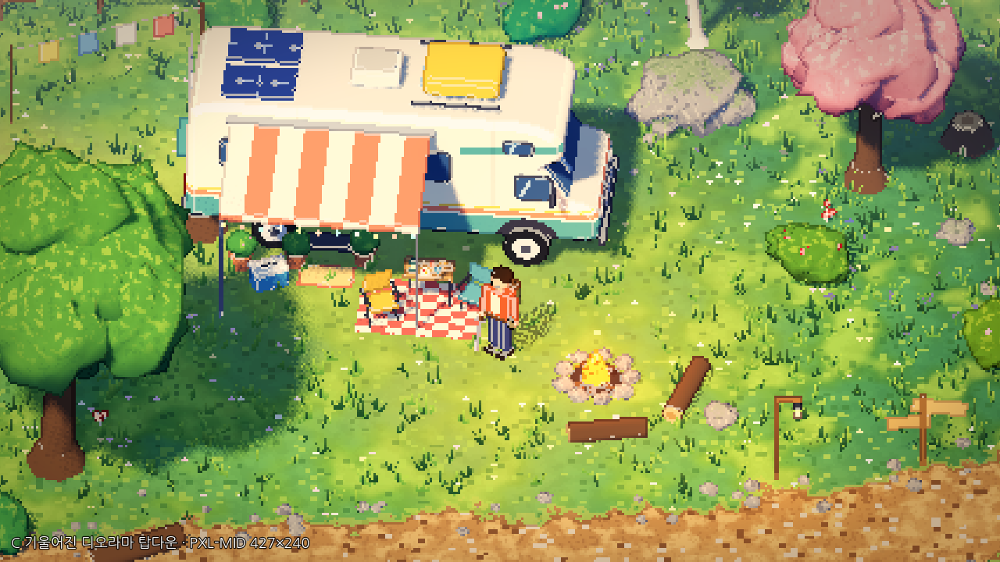

# Denial — P0 그래픽 기술 검증 프로토타입

힐링 판타지 RPG(가칭, Godot 프로젝트명 **Denial**)의 **P0 시각 기술 검증**용 Godot 프로젝트입니다.
완성 게임이 아니라 **고정 탑다운 카메라 + 3D 월드의 픽셀화 렌더**가 이 게임의 아트 스타일로 쓸 만한지를
직접 걸어 다니며 비교하기 위한 테스트 씬입니다. 기획 기준 문서는 [`docs/`](docs/)에 있습니다.



> **비주얼 방향 수정(디오라마형 3D 픽셀풍)과 카메라 A/B/C 비교 결과:** [`notes/VISUAL_DIRECTION.md`](notes/VISUAL_DIRECTION.md)
> **캠핑카 모델 비교(절차형 vs Tripo GLB):** [`notes/CAMPER_MODEL_COMPARISON.md`](notes/CAMPER_MODEL_COMPARISON.md)

## 요구 사항

| 항목 | 내용 |
|---|---|
| 엔진 | **Godot 4.7.x 표준판**(.NET 판 불필요). 4.7.2-stable로 작성·검증 |
| 렌더러 | Forward+ (기본). Vulkan을 지원하는 GPU 필요 |
| 저사양 대안 | Compatibility(OpenGL) 렌더러로도 실행 확인됨 (아래 "실행" 참고) |
| 외부 에셋 | 폰트(나눔고딕, SIL OFL 1.1, `assets/fonts/LICENSE_NanumGothic.txt`), 비교용 캠핑카 GLB(사용자 제공, Tripo AI 생성, **라이선스 미확인** — `assets/models/SOURCE.md`). 그 외 모델·재질·셰이더는 코드로 생성 |

## 설치 (`C:/Game/denial`)

이 저장소의 **루트가 곧 Godot 프로젝트 폴더**입니다(`project.godot`가 루트에 있음).

```bat
cd C:\Game
:: 기존에 에디터로 만든 빈 denial 프로젝트가 있다면 먼저 다른 이름으로 옮겨 두세요.
ren denial denial_old
git clone -b claude/gallant-edison-84bkyp https://github.com/HomilBBANG/rg_Hilling_RPG.git denial
```

그다음 Godot 프로젝트 매니저 → **가져오기(Import)** → `C:/Game/denial/project.godot`을 선택합니다.
처음 열 때 `.godot/` 캐시가 자동 생성됩니다(커밋하지 않음).

## 실행

- **F5**: 메인 씬 `scenes/bootstrap.tscn` 실행 (야외 랩에서 시작).
- **F6**: `scenes/visual_lab.tscn` 또는 `scenes/camper_interior_lab.tscn`을 연 상태에서 실행하면,
  픽셀 렌더 파이프라인과 HUD를 갖춘 bootstrap으로 자동 전환되며 해당 씬에서 시작합니다.
- GPU가 Vulkan을 지원하지 않으면: `Godot.exe --path C:/Game/denial --rendering-method gl_compatibility`

## 조작 (P0 디버그 전용 임시 키 — 최종 게임 키가 아님)

| 키 | 기능 |
|---|---|
| `WASD` / 방향키 | 이동 (`Shift` 달리기 — P0에서는 SP 소모 없음) |
| 마우스 왼쪽 클릭 | 기본 공격 모션 1회 (마우스 방향, 누르고 있어도 반복 안 함) |
| `F` | 캠핑카 외부 라이트 ON/OFF (캠핑카 7.5m 이내에서만) |
| `V` | **카메라 스타일 A(기존 기능형) → B(개선된 탑다운) → C(기울어진 디오라마)**. 시작은 C |
| `O` | 픽셀 외곽선 ON/OFF (B/C, Forward+ 전용) |
| `G` | 캠핑카 모델: 절차형 → Tripo GLB(원본 PBR) → Tripo GLB(툰 변환) |
| `1` / `2` / `3` / `4` | **PXL-COARSE 320×180** / **PXL-MID 427×240(기본)** / **PXL-SOFT 640×360** / **3D-NATIVE 1280×720(픽셀화 OFF)** |
| `M` | 픽셀화 파이프라인 전환: M1 SubViewport 확대 ↔ M2 3D 해상도 스케일링(nearest) |
| `P` | 모드 3: 색 단계 제한 + 4×4 디더 ON/OFF (색보정 셰이더 안의 옵션) |
| `N` | 낮(12:00) ↔ 밤(22:00) |
| `T` | 게임 시계 진행/정지 (현실 1초 = 게임 1분) |
| `L` | 개인 등불(허리띠) ON/OFF |
| `I` | 캠핑카 실내 ↔ 야외 씬 전환 |
| `K` | 픽셀 스냅 카메라 ON/OFF (떨림 비교용) |
| `C` | 직교 ↔ 원근 투영 비교 (카메라 **회전은 없음**) |
| `X` | 가림 보조: 실루엣 → 수관 디더 투명화 → 끔 |
| `-` / `=` | 카메라 규모(화면 세로 9~22m) |
| `F12` | 스크린샷 → `user://captures` (Windows: `%APPDATA%\Godot\app_userdata\Denial\captures`) |
| `ESC` | 일시정지 |
| `H` | 도움말 패널 표시/숨김 (시작 시 표시됨) |

## 렌더 구조 (P1 재사용 대상)

```
bootstrap (Node)
├─ PixelRenderController (Control)        scripts/visuals/pixel_render_controller.gd
│   ├─ SubViewport  ← 3D 월드(야외/실내)가 여기서 저해상도로 렌더
│   └─ TextureRect  ← nearest 필터, 정수 배율 확대, 서브텍셀 오프셋
└─ CanvasLayer → VisualHud                ← 고해상도 UI (픽셀화 영향 없음)
```

- **픽셀 스냅 카메라** (`scripts/visuals/topdown_camera.gd`): 고정 각도(피치 50°) 직교 카메라가 렌더 텍셀
  격자에 위치를 맞추고, 남는 서브텍셀 오차는 TextureRect를 화면 픽셀 단위로 밀어 보정합니다(1텍셀 여백 렌더).
  배경은 떨리지 않고 스크롤은 부드럽게 유지하는 표준 기법입니다.
- **M2**는 Godot 4.7의 `Viewport.scaling_3d_mode = SCALING_3D_MODE_NEAREST`를 사용합니다.
- **픽셀 외곽선** (`shaders/pixel_outline_post.gdshader`): 카메라에 붙은 전체 화면 쿼드가 저해상도 렌더의 깊이·노멀 버퍼를
  읽어, 앞 물체의 경계 텍셀을 어둡게(색 있는 외곽선), 단단한 소품의 볼록 모서리를 밝게 칠합니다. 지형·풀(roughness 1.0)과
  잎·바위(0.93)는 하이라이트에서 제외합니다.
- **색보정** (`shaders/pixel_grade.gdshader`): 업스케일 TextureRect에서 텍셀 단위로 스플릿 토닝·채도·비네트(+선택 디더).
- **스타일라이즈드 재질** (`scripts/world/stylized_materials.gd`): 지형·잎·바위·풀 셰이더와 절차적 노이즈 텍스처.
- 낮/밤: `scripts/visuals/day_night_controller.gd`, 오토로드 `Game`(`scripts/core/game.gd`)이 시계·라이트 상태 보관.
- 가림 실루엣: `shaders/occluded_silhouette.gdshader` (`depth_test_inverted` + 자기 가림 방지 바이어스).

P1에서는 `PixelRenderController`, `TopdownCamera`, `DayNightController`, 실루엣 셰이더를 그대로 가져가고
`visual_lab.gd`/`camper_interior_lab.gd` 같은 월드 스크립트만 교체하면 됩니다.

### 폴더

```
project.godot
scenes/        bootstrap.tscn, visual_lab.tscn, camper_interior_lab.tscn (루트 노드 + 스크립트만)
scripts/core/      game.gd(오토로드), bootstrap.gd, visual_hud.gd
scripts/visuals/   pixel_render_controller.gd, topdown_camera.gd, day_night_controller.gd
scripts/world/     visual_lab.gd, camper_interior_lab.gd, terrain_field.gd, nature_props.gd, proto_mesh.gd,
                   organic_mesh.gd, stylized_materials.gd, ground_cover.gd, camp_props.gd, campfire_flame.gd
scripts/actors/    prototype_player.gd, slime_visual.gd
scripts/vehicle/   camper_exterior.gd, prototype_camper_lights.gd
shaders/           terrain/foliage/rock_stylized, grass_blades, camper_paint, pixel_outline_post,
                   pixel_grade, occluded_silhouette (+ stylized_common.gdshaderinc)
captures/visual_direction/  카메라 A/B/C 비교 (디오라마 방향)
captures/p0_baseline/       P0 테스트 장면 6종 + 렌더 모드 비교 + 이동 영상
notes/             VISUAL_DIRECTION.md, VISUAL_COMPARISON.md, IMPLEMENTATION_ASSUMPTIONS.md
docs/              GDD.md, GRAPHICS_PROTOTYPE.md, CLAUDE_CODE_HANDOFF.md
```

`GRAPHICS_PROTOTYPE.md` 6장의 `actors/*.tscn`, `props/*.tscn`은 별도 씬 파일로 만들지 않고, 같은 역할을
스크립트 클래스(`PrototypePlayer`, `SlimeVisual`, `CamperExterior`, `NatureProps`)로 절차 생성했습니다.

## 캡처 재생성

모든 `captures/` 파일은 아래 자동 투어로 생성되었습니다(같은 카메라 위치에서 모드만 바꿔 촬영).

```bat
:: 카메라 A/B/C 비교 8장
Godot.exe --path C:/Game/denial -- --tour=styles --capture-dir=C:/Game/denial/captures/visual_direction
:: P0 스크린샷 18장
Godot.exe --path C:/Game/denial -- --tour=shots --capture-dir=C:/Game/denial/captures/p0_baseline
:: 14초 이동 영상 (Movie Maker, AVI → 필요 시 ffmpeg로 MP4 변환)
Godot.exe --path C:/Game/denial --write-movie C:/Game/walk.avi --fixed-fps 30 -- --tour=walk
```

## 알려진 문제 / 미검증

- **실제 GPU에서 실행하지 않았습니다.** 검증은 클라우드 컨테이너의 소프트웨어 렌더러(Mesa llvmpipe, Vulkan
  Forward+ 및 OpenGL Compatibility)에서 했습니다. FPS 수치(8~30)는 소프트웨어 렌더 기준이라 의미가 없습니다.
- 픽셀 외곽선은 Forward+ 전용이며 Compatibility에서는 자동으로 꺼집니다(디오라마 버전은 Compatibility에서 미검증).
- 이동 중 픽셀 떨림은 녹화 영상의 프레임으로만 확인했습니다. **실시간 체감은 직접 실행해서 판단**해 주세요.
- Forward+와 Compatibility의 밤 밝기가 다릅니다(Compatibility가 더 밝고 헤드라이트 빔이 더 뚜렷함).
- 창 크기를 1280×720이 아닌 크기로 바꾸면 `canvas_items` 스트레치 때문에 픽셀이 비정수 배율로 늘어납니다.
- 자세한 시각 평가와 P0 통과/보류 체크리스트: [`notes/VISUAL_COMPARISON.md`](notes/VISUAL_COMPARISON.md)
- 임시로 정한 값과 미정 사항 처리: [`notes/IMPLEMENTATION_ASSUMPTIONS.md`](notes/IMPLEMENTATION_ASSUMPTIONS.md)
