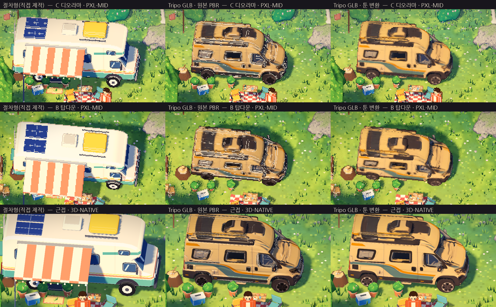

# 캠핑카 모델 비교 — 절차형 vs Tripo GLB

> 사용자 제공 `camper_van_3d_model.glb`(Tripo AI 생성, 약 50만 삼각형, 4096² 텍스처 3장)를 프로젝트에 넣고
> 같은 위치·시각(10:30)·카메라에서 기존 절차형 캠핑카와 비교했습니다. 검증 환경: Godot 4.7.2, 소프트웨어 렌더러(실제 GPU 미검증).

## 실행

야외 씬에서 **`G`** → 절차형 → Tripo GLB(원본 PBR) → Tripo GLB(툰 변환). 기본값은 절차형.
재생성: `Godot --path . -- --tour=camper_models --capture-dir=<폴더>`

| 변형 | 처리 |
|---|---|
| 절차형 | 기존 캠핑카(압출 실루엣 + 도색 셰이더 + 차양) |
| GLB · 원본 PBR | 임포트 그대로(baseColor + roughness/metal + normal 맵) |
| GLB · 툰 변환 | baseColor만 유지, normal/roughness 맵 제거, 툰 디퓨즈, 러프니스 0.85(외곽선은 받고 모서리 하이라이트는 제외) |

GLB는 지붕 높이 3.3m로 맞췄습니다(길이 약 5.8m, 폭 약 2.85m). 원래 앞이 +X라 회전은 하지 않았습니다.
라이트(F)·충돌·실내 전환 로직은 공통이고, 절차형의 램프 메시만 숨깁니다.

## 관찰

**Tripo GLB의 장점**
- 근접 원본 해상도에서는 형태 정보가 가장 많습니다. 스프린터형 밴 실루엣, 슬라이딩 도어, 루프 랙, 오프로드 휠, 측면 스우시가 보여 **"현대 캠핑카"로 즉시 읽힙니다**.
- 박스형 인상이 전혀 없습니다.

**Tripo GLB의 단점 (픽셀 화면 기준)**
1. **427×240에서는 표면이 탁하고 지저분합니다.** AI 텍스처에 구워진 음영(지붕의 검은 얼룩, 보닛 주름)이 씬 조명과 따로 놀고, 텍셀 단위로 줄이면 얼룩으로 남습니다.
2. **원본 PBR은 외곽선 패스와 충돌합니다.** 고밀도 메시 + 노멀맵 때문에 모서리 하이라이트가 흰 잡티로 쏟아집니다. 툰 변환에서 하이라이트를 빼서 해결했습니다.
3. **아트 스타일이 섞입니다.** 반실사 질감이라 주변의 손그림풍 환경·박스형 인물과 톤이 맞지 않습니다. 툰 변환 쪽이 덜 튀지만, 여전히 텍스처가 그림이 아니라 사진처럼 보입니다.
4. **무겁습니다.** 50만 삼각형 + 4K 텍스처 3장. 화면에서 수백 픽셀을 차지하는 오브젝트로는 과합니다(Godot이 LOD를 자동 생성하지만 원본 용량은 그대로입니다). 저장소 용량은 약 21MB 늘었습니다.
5. 실사 비율이라 차양·캠프 소품이 없고, "집 같은" 생활감은 절차형(차양 + 줄전구)이 더 강합니다.

**절차형의 장점/단점**
- 색 분할이 깨끗해서 픽셀화 후에도 창문·줄무늬·바퀴가 또렷합니다. 씬 전체와 스타일이 일치하고 가볍습니다.
- 대신 형태가 단순하고, 근접하면 장난감처럼 보입니다.

## 판단

- **픽셀 화면(PXL-MID) 기준: 절차형 > GLB 툰 변환 > GLB 원본 PBR.**
- GLB의 **형태(실루엣·비율·디테일 배치)는 매우 좋은 레퍼런스**이고, 문제는 대부분 **텍스처와 폴리곤 밀도**입니다.
- 추천 방향(제안): Tripo 모델을 **형태 레퍼런스나 베이스 메시로 쓰고**, Blender 등에서 ① 5천~1만 삼각형으로 리토폴로지/데시메이트,
  ② 구워진 음영이 없는 평면 색 영역(크림/청록/주황 + 창문 남색)으로 다시 칠하거나 소수의 단색 재질로 나누기,
  ③ 차양·줄전구 같은 생활 소품을 붙이면 두 방식의 장점을 합칠 수 있습니다.
  Tripo에서 다시 생성한다면 "low poly, flat colors, no baked lighting, stylized" 계열 옵션이나 프롬프트가 이 파이프라인에 맞습니다.

## 라이선스

`assets/models/SOURCE.md` 참고. Tripo 생성물의 이용 조건은 생성 계정의 요금제에 따라 다르므로 **배포 전 확인이 필요**합니다(현재 미확인).

## 캡처 (`captures/camper_model/`)

`00_camper_model_comparison.png`(3×3 요약), `camper_C_{0,1,2}.png`, `camper_B_{0,1,2}.png`, `camper_closeup_native_{0,1,2}.png`
(0 = 절차형, 1 = GLB PBR, 2 = GLB 툰)
