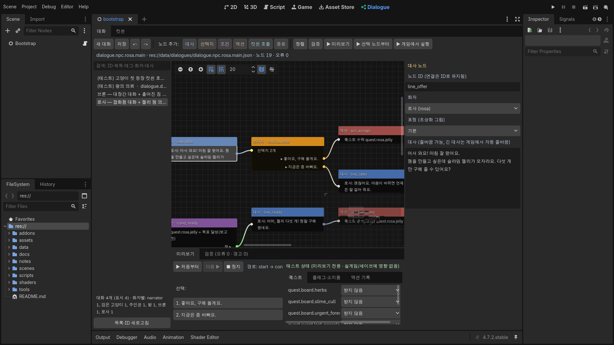
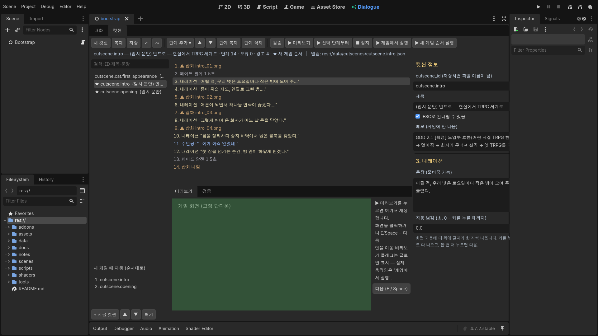

# 대화 에디터 (Dialogue Editor) — 사용법과 구조

`docs/DIALOGUE_EDITOR_HANDOFF.md`(v10.5)에 따라 만든 **노드형 대화 에디터**입니다. 대사·선택지·조건·액션·컷씬
호출을 코드 없이 작성하고, 에디터 안에서 미리보기·검증하고, 실제 게임에서 바로 실행할 수 있습니다.
UI 형태(Godot `EditorPlugin` + `GraphEdit`), 데이터 포맷, 단축키는 핸드오프의 **제안안을 구현한 개발용 초기안**이며
사용자 승인 전입니다.



## 여는 법

1. Godot 4.7 에디터로 프로젝트를 엽니다: `Godot.exe --path C:/Game/denial -e` (또는 프로젝트 매니저에서 열기).
2. 화면 위쪽 **2D · 3D · Script · Game … 옆의 `Dialogue`** 탭을 누릅니다.
   - 탭이 안 보이면: 프로젝트 → 프로젝트 설정 → 플러그인 → **Dialogue Editor** 사용 체크.

## 작업 흐름 (핸드오프 5장)

| 단계 | 방법 |
|---|---|
| 새 대화 / 열기 | `새 대화` → `dialogue_id`(예: `dialogue.npc.rosa.rain`)와 제목 입력. 왼쪽 목록에서 클릭해 열기. 검색창은 ID·제목·태그·화자 이름·**대사 본문**까지 찾음. 목록 아래에 화자별 대화 수 |
| 노드 추가 | 위쪽 `대사 / 선택지 / 조건 / 액션 / 컷씬 호출 / 종료` 버튼 — **선택한 노드의 빈 출력에 자동으로 이어 붙음**. 그래프 오른쪽 클릭, 출력 점에서 빈 곳으로 선을 끌어 놓아도 추가 |
| 연결 | 출력 점(오른쪽) → 입력 점(왼쪽)으로 끌기. 출력 하나에는 대상 하나(다시 연결하면 교체). 끊기: 입력 쪽 선 끝을 오른쪽 클릭으로 끌기 |
| 편집 | 노드를 클릭하면 **오른쪽 속성 패널**에서 편집(그래프에는 1~2줄 미리보기만). 대사는 여러 줄 입력·붙여넣기 가능, 화자·퀘스트·아이템·컷씬은 목록에서 고름(오타 방지). 노드 ID는 바꿔도 연결 유지 |
| 미리보기 | `▶ 미리보기`(처음부터) / `▶ 선택 노드부터`. 아래 미리보기 탭에서 대사 진행·선택지 클릭, 현재 노드는 그래프에서 **노란색으로 강조**, 지나온 경로와 액션 기록 표시. 오른쪽 **테스트 상태**(퀘스트 상태·플래그·골드·소지품)를 바꿔 조건별 결과 확인 — 실게임·세이브에는 영향 없음 |
| 검증 | `검증` → 검증 탭. 항목을 클릭하면 해당 노드로 이동. 오류가 있는 노드는 제목에 ⚠ |
| 저장 | `저장` / **Ctrl+S** → `res://data/dialogues/<dialogue_id>.json`. 오류가 있으면 확인 후 저장 가능(작성 중 초안). 덮어쓰기 전 이전 내용을 `user://dialogue_backups/<id>/`에 백업(최근 20개), 파일이 에디터 밖에서 바뀌었으면 덮어쓰기 전에 물어봄 |
| 게임에서 실행 | `▶ 게임에서 실행` → 저장 후 게임을 켜고, 로딩이 끝나면 그 대화를 **실제 대화창·실제 게임 상태**로 재생 |
| NPC에 연결 | `data/speakers.json`의 `"talk"` 값을 대화 ID로 바꾸면 그 NPC에게 `R`로 말을 걸 때 열림 — **GDScript 수정 불필요** |

단축키: Ctrl+S 저장 · Ctrl+Z / Ctrl+Y(또는 Ctrl+Shift+Z) 실행 취소·다시(입력 칸 밖에서) · Delete 노드 삭제 ·
Ctrl+C / Ctrl+V 복사·붙여넣기(내부 연결 유지, 새 ID) · Ctrl+D 복제 · `정렬` 자동 배치 · 드래그로 다중 선택.

## 컷씬 탭 (`Dialogue` 화면 위쪽 `대화 | 컷씬`)

인트로 같은 **그림+내레이션 컷씬**과 게임 화면 안의 **인게임 컷씬**을 같은 방식으로 만듭니다. 컷씬은 단계 목록이고,
게임은 그 순서대로 재생합니다(카메라는 고정 탑다운 그대로).



| 할 일 | 방법 |
|---|---|
| 새 컷씬 / 열기 / 복제 | `새 컷씬` → `cutscene_id`(예: `cutscene.story.dragon_offer`)와 제목. 왼쪽 목록에서 열기(★ = 새 게임 때 재생). `복제`는 다른 ID로 복사 |
| 단계 추가 | `단계 추가 ▾`에서 종류 선택 → **선택한 단계 다음에** 들어감. `▲ ▼`로 순서, `단계 복제`, `단계 삭제`(Delete) |
| 편집 | 단계를 클릭하면 오른쪽에서 편집. 화자·표정·인물은 목록에서 고르고, 삽화는 `찾기…`로 파일 선택(미리보기 그림 표시) |
| 미리보기 | `▶ 미리보기` / `▶ 선택 단계부터`(단계 두 번 클릭도 같음). 아래 화면에서 삽화·내레이션(한 자씩)·초상화 대사·페이드·영화 띠·자막이 재생되고, 클릭 또는 E/Space로 넘김. 인물 이동·바라보기·플래그는 글로만 표시 |
| 검증 | 빈 문장, 등록 안 된 화자·인물, 없는 표정, 아직 없는 그림 파일(경고 — 게임에선 자리표시) |
| 저장 | Ctrl+S → `data/cutscenes/<cutscene_id>.json`, 덮어쓰기 전 백업, 밖에서 바뀌면 확인, Ctrl+Z/Y 실행 취소 |
| 새 게임 순서 | 왼쪽 아래 "새 게임 때 재생": `+ 지금 컷씬`, `▲ ▼`, `빼기` → `data/story.json`. 새 게임을 누르면 이 순서대로 재생 |
| 게임에서 실행 | `▶ 게임에서 실행`(이 컷씬) / `▶ 새 게임 순서 실행`(인트로부터 전부) |
| 대화에서 부르기 | 대화의 `컷씬 호출` 노드 → 속성 패널의 `컷씬 탭에서 편집` 버튼으로 바로 이동 |

### 단계 10종

| 단계 | 하는 일 |
|---|---|
| 화면 페이드 | 어둡게(암전)/밝게, 시간. 컷씬이 검은 화면으로 끝나면 자동으로 다시 밝아짐(새 게임 순서 중간은 다음 컷씬이 밝힘) |
| 삽화 | 전체 화면 그림(16:9로 채움, `assets/cutscenes/`). 비우면 내림. 없는 파일은 "삽화 자리" 카드 |
| 내레이션 | 화면 가운데 띠에 한 자씩. 키 → 바로 다 보임 → 한 번 더 → 다음. 자동 넘김 시간도 지정 가능 |
| 대사 | 초상화 대화창(주인공 왼쪽·상대 오른쪽, 말 안 하는 쪽 50%), 화자·표정·대사 |
| 자막 | 화면 아래 짧은 자막, 표시 시간 |
| 대기 | 시간 |
| 영화 띠 | 위아래 검은 띠 켜기/끄기 (인게임 컷씬용) |
| 인물 이동 | 주인공·고양이(걸어감)·NPC(바로 이동)를 다른 인물 옆 또는 좌표로. 자기 자신을 고르면 지금 자리에서 그만큼 걸어감 |
| 인물 바라보기 | 누가 누구를 봄 |
| 플래그 설정 | 진행 플래그 켜기/끄기 (대화 조건에서 사용) |

게임에서: E/Space/클릭 = 다음, **ESC = 컷씬 건너뛰기**("ESC로 건너뛸 수 있음"을 켠 컷씬만). 건너뛰어도 플래그·인물 위치·마지막 화면은
끝까지 재생한 것과 같게 적용됩니다. 컷씬 동안 조작 잠금, HUD 숨김.

## 노드 7종

| 노드 | 하는 일 | 출력 |
|---|---|---|
| 시작 | 진입점, 그래프당 하나(지울 수 없음) | 다음 |
| 대사 | 화자 + 대사 (게임에서 자동 줄바꿈) + 표정(초상화 그림, 화자에 등록된 것 중 선택, 기본값 비움) | 다음 |
| 선택지 | 선택지별 분기. 선택지마다 "조건이 맞을 때만 보이기" 가능 | 선택지마다 하나 |
| 조건 | 상태를 **조회만** 해서 분기: 플래그 / 퀘스트 상태 / 아이템 개수 / 골드 / 이벤트 완료 | 참 · 거짓 |
| 액션 | 허용 목록만: `set_flag`, `quest_accept`, `quest_advance`, `quest_complete`(보상은 퀘스트 데이터), `mark_event_complete` | 다음 |
| 컷씬 호출 | `data/cutscenes/*.json` 컷씬(위 컷씬 탭에서 작성)을 재생하고 끝나면 진행. 카메라는 고정 탑다운 그대로 | 다음 |
| 종료 | 대화를 끝내고 조작 반환. 선택적으로 이벤트 완료 기록(재생해도 한 번만) | — |

대사·조건·사용자 입력을 코드로 실행(`eval`/`Expression`)하는 경로는 없습니다. 같은 퀘스트 수락·보상은 다시 재생해도
중복 적용되지 않습니다(QuestManager가 상태로 막음).

## 데이터 (버전 1, UTF-8 JSON)

```
data/dialogues/<dialogue_id>.json   대화 (version, dialogue_id, metadata{title,tags,notes}, start_node_id, nodes, connections, editor_positions)
data/quests/<quest_id>.json         퀘스트 (목표·보상·결과 분기·시간 제한·반복·현장 사건 트리거)
data/cutscenes/<cutscene_id>.json   컷씬 (version, cutscene_id, title, notes, skippable, steps — 단계 종류·필드는 scripts/dialogue/cutscene_data.gd STEPS)
data/story.json                     새 게임 때 재생할 컷씬 순서 {"new_game": [...]}
data/speakers.json                  화자 ID → 표시 이름, NPC가 여는 대화(talk), 대화창 초상화 그림 경로(portrait, 생략 시 assets/portraits/<id>.png)
```

- 연결은 `connections`에만 저장하고 노드 ID로 잇습니다(표시 이름·위치를 바꿔도 끊기지 않음).
- 형식 설명은 `scripts/dialogue/dialogue_data.gd`, `scripts/game/quest_db.gd`, `scripts/dialogue/cutscene_runner.gd` 맨 위 주석.
- 내보내기(export) 빌드를 만들 때는 내보내기 설정의 "리소스가 아닌 파일 포함"에 `data/*.json`을 넣어야 합니다(아직 내보내기 설정 없음).

## 구조 — 에디터와 런타임 분리

```
addons/dialogue_editor/        에디터 전용 (빌드에서 필요 없음)
  plugin.gd                    EditorPlugin: Dialogue 메인 화면, '게임에서 실행' 파일 전달
  dialogue_editor_panel.gd     목록·그래프·속성·미리보기·검증·저장·실행 취소 (대화 탭)
  cutscene_editor_panel.gd     컷씬 탭: 단계 목록·속성·미리보기·검증·저장·새 게임 순서
  editor_selftest.gd           자동 점검 시나리오
scripts/dialogue/              런타임 (에디터 미리보기와 게임이 같은 코드 사용)
  dialogue_data.gd             파일 읽기/쓰기, 스키마, 검증기, 조건 판정
  dialogue_runner.gd           대화 실행기 (start / next / choose)
  dialogue_context.gd          미리보기용 샌드박스 상태
  game_dialogue_context.gd     실게임 상태 연결 (NarrativeState, QuestManager, 소지품, 골드)
  cutscene_data.gd             컷씬 포맷·단계 정의(STEPS)·검증 — 게임과 에디터 공용
  cutscene_runner.gd           게임 안 컷씬 재생 (건너뛰기, 주인공 걷기)
scripts/ui/dialogue_box.gd     게임 대화창 (컷씬의 대사 단계도 여기에)
scripts/ui/cutscene_overlay.gd 컷씬 화면 층: 삽화·내레이션·영화 띠·페이드
```

## 검증 방법과 결과

- **실제 Godot 4.7.2 에디터 안에서** 플러그인을 띄워 자동 점검(`DIALOGUE_EDITOR_SELFTEST=<캡처 폴더>` 환경 변수로 에디터 실행):
  열기 → 속성 → 미리보기(퀘스트 '받지 않음'이면 의뢰 분기, '목표 달성'이면 보고 분기) → 새 대화를 7종 노드로 작성 →
  오타 퀘스트 ID·연결 없는 선택지를 검증기가 찾음 → 수정 후 오류 0 → 숨김 선택지·컷씬 단계 미리보기 →
  실행 취소/다시 → 복사/붙여넣기 → 노드 이름 변경 후 연결 유지 → 저장 → 다시 열기 후 **노드·연결·문장·위치 동일** →
  한글·줄바꿈 보존 → 밖에서 바뀐 파일은 덮어쓰기 전에 확인 → **컷씬 탭**: 인트로 열기 → 새 컷씬에 단계 10종 추가 →
  빈 문장·플래그 키 오류 검출 → 수정 후 오류 0 → 순서 바꾸기·실행 취소·다시 → 저장·다시 열기 동일 → 새 게임 순서 추가(복원) →
  미리보기 끝까지 재생. **23개 항목 모두 통과**.
  캡처: `captures/dialogue_editor/`.
- 게임 쪽은 `--tour=quest`로 같은 데이터를 실제 대화창에서 재생(아래 README 캡처 재생성 참고).
- 검증은 클라우드 컨테이너의 소프트웨어 렌더러(xvfb)에서 했습니다. **실제 Windows 에디터에서의 마우스 조작감(드래그·연결)은 직접 확인이 필요합니다.**

## 아직 안 한 것 (핸드오프 P2 품질 개선 중)

CSV/JSON 내보내기, 로컬라이제이션 키, 일괄 치환, 다른 대화 호출(재사용) 노드, 조건 템플릿, 시간축(타임라인) 방식 컷씬 편집
(지금은 단계 목록 방식), 에디터 미리보기 안의 실제 인물 움직임(지금은 글로만 표시하고 실제 움직임은 '게임에서 실행').
