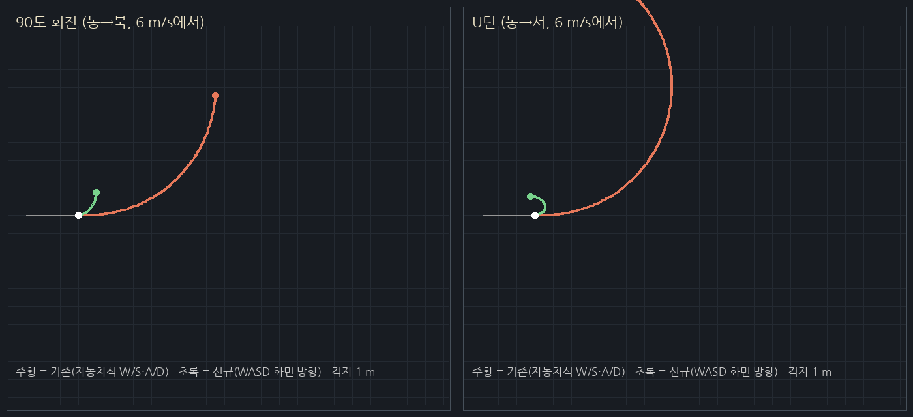

# 캠핑카 운전 조작 개선 (CAMPERVAN_DRIVING_HANDOFF / GDD 9.7)

> 기획 원본(`docs/CAMPERVAN_DRIVING_HANDOFF.md`)이 우선합니다. 아래 수치는 모두 **임시값**이며 최종 밸런스가 아닙니다.
> GDD v10.3 본문(9.7)은 아직 저장소에 없어서 핸드오프 문서만 기준으로 했습니다.

## 기존 조작의 문제 원인

| 증상 | 원인 (`camper_vehicle.gd` 이전 버전) |
|---|---|
| 답답함 | 가속 4.5 m/s²로 5 m/s까지 1.1초, 조향 핸들이 2.5 rad/s로 천천히 꺾임 |
| 회전 불편 | 자동차식 조작: W/S 가속·후진, A/D는 **차 기준** 좌우 조향. 고정 탑다운 화면에서는 차가 아래를 향하면 좌우가 뒤바뀜. 축간 4.4 m·최대 조향 32°로 회전 반경 약 7 m, 정지 상태에서는 회전 불가 |
| 미끄러짐 | 자연 감속 2.5 m/s²라 키를 놓아도 약 2.4초·6.9 m를 굴러감 |

옆으로 미끄러지는 속도 성분은 원래도 없었습니다(아래 측정에서 0.01 m/s). 체감되는 "미끄러짐"은 긴 관성 주행이었습니다.
엔진 노드는 바꾸지 않았습니다. `CharacterBody3D`(충돌체 박스)를 그대로 두고 이동 계산만 아케이드식으로 바꿨습니다.
차체 충돌, 실내 출입, 운전석 승하차, F 라이트, 주차 위치 저장, 16방향 스프라이트는 그대로입니다.

## 현재 조작 (기본값 `HEADING`) — 차 머리 기준, 사용자 지정

> 시운전 의견에 따라 두 번 바뀌었습니다. ① 핸드오프대로 WASD = 화면 방향 + Space 제동 + R 후진 → "후진 불편"
> ② WASD만, 끼면 자동 후진 → "너무 제멋대로" ③ **지금: 차 머리 기준 W/S/A/D, 자동 동작 없음.**
> 핸드오프의 "WASD 자동 조향" 방식은 사용자 결정으로 기본값에서 빠졌고, `control = ARCADE`로 남겨 두었습니다.

- **W** 전진(차 머리 방향), **S** 굴러가는 중이면 브레이크, 멈추면 후진
- **A / D** 차 머리를 왼쪽 / 오른쪽으로 돌림. 정지 중에도 돌고, 후진 중에도 같은 방향(A = 머리 왼쪽)
- 키를 놓으면 짧게 감속해 멈춤. 차가 스스로 움직이는 동작은 없음
- 속도는 항상 차체 방향이라 옆걸음이 없음. 깊이 파고드는 회전만 막고 얕은 접촉은 허용
- 카메라 회전 없음

### 이전 방식 (비교용으로 남김)

- `ARCADE`: WASD = 화면 기준 목표 방향, 끼면 자동으로 물러나며 회전 (아래 `arcade_*`/`unstick_*` 변수)
- `LEGACY`: 첫 P1 자동차식 (느린 가속, 핸들 각도, 긴 관성)

## 튜닝 변수 (`CamperVehicle`, Inspector에서 조정 가능)

| 변수 | 임시값 | 의미 |
|---|---|---|
| `control` | `HEADING` | `ARCADE`(화면 방향식) / `LEGACY`(초기 자동차식) 비교용 |
| `heading_max_speed` | 6 m/s | W 최고 속도 |
| `heading_reverse_speed` | 3 m/s | S 후진 속도 |
| `heading_accel` | 12 m/s² | 가속 |
| `heading_brake` | 30 m/s² | 진행 반대 키(전진 중 S, 후진 중 W) 제동 |
| `heading_coast` | 16 m/s² | W/S를 놓았을 때 감속 |
| `heading_turn_deg` | 110 °/s | A/D 회전 속도 |
| — 아래는 `ARCADE` 모드 변수 — | | |
| `max_speed` | 6 m/s | 최고 속도 |
| `acceleration` | 14 m/s² | 가속 |
| `coast_decel` | 20 m/s² | 키를 놓았을 때 감속 (= 정지 수단) |
| `max_turn_deg` | 480 °/s | 정지·저속 최대 회전 속도 |
| `high_speed_turn_deg` | 240 °/s | 최고 속도에서의 회전 속도 (사이는 선형) |
| `sharp_turn_slowdown` | 0.35 | 목표 방향과 45° 이상 어긋난 동안 속도 비율 |
| `unstick_speed` | 3 m/s | 자동 빠져나오기 후진 속도 |
| `unstick_time` | 0.6 s | 자동 빠져나오기 1회 길이 (막혀 있는 동안 끊김 없이 이어짐) |

핸드오프 문서에 없던 값(`high_speed_turn_deg`, `sharp_turn_slowdown`, `unstick_*`)도 임시 가정입니다.

## 비교 측정 (같은 필드·같은 W/S/A/D 입력, 자동 투어 `--tour=drive`)

| 항목 | 초기 자동차식 (`LEGACY`) | 현재 머리 기준 (`HEADING`) |
|---|---|---|
| 정지 → 5 m/s (W) | 1.12초 | 0.42초 |
| 90° 회전 (6 m/s에서 W+A) | 1.37초, 앞 7.5 m·옆 6.6 m | 0.78초, 앞 3.0 m·옆 3.0 m |
| U턴 (6 m/s에서 W+A) | 2.58초, 앞 7.5 m·옆 14.1 m | 1.60초, 앞 3.0 m·옆 6.2 m |
| S 브레이크 (6 m/s) | 0.58초, 1.6 m | 0.18초, 0.46 m |
| 키 놓기 (6 m/s) | 2.35초, 6.9 m 굴러감 | 0.37초, 0.98 m |
| 옆걸음 최대 (평지) | 0.01 m/s | 0.01 m/s |
| 벽에 정면 충돌 → S 1초 → W+A | 0.4 m (다시 벽에 걸림) | 8.0 m 빠져나감 |
| 막다른 좁은 통로 → S 3.2초 → W+A | 5.3 m 후진, 아직 통로 안 | 12.4 m 후진해 통로를 벗어나 회전 |

벽·통로 시험은 시험용 벽만 충돌하는 별도 물리 레이어에서 했습니다.
(`ARCADE` 방식의 측정값은 이 문서의 이전 버전 git 기록에 있습니다.)

키 입력 확인(`--tour=p1input`): W 누름 → 6 m/s 직진(방향 변화 0°), 놓으면 정지, A → 머리 왼쪽(+), D → 머리 오른쪽(−), S → −3 m/s 후진,
E 승하차·문 출입·F9·ESC 정상.

## 검증하지 못한 것 / 남은 문제

- **내구도 0 운행 금지, 연료 소모, 빠른 이동**: 이 프로젝트에는 아직 내구도·연료·빠른 이동 시스템이 없어 검사할 대상이 없습니다(깨뜨릴 기능도 없음). 해당 시스템을 만들 때 `CamperVehicle`에서 운행 가능 여부를 막으면 됩니다.
- **픽셀 지터**: 카메라가 차량 위치에 텍셀 단위로 고정되어 차 자체는 화면에서 떨리지 않습니다. 480°/s 회전은 16방향 그림을 0.75초 만에 한 바퀴 돌리므로 급회전 때 방향 그림이 빠르게 넘어갑니다. 실제 화면에서 거슬리는지는 직접 확인이 필요합니다.
- **캠프 안쪽**: 처음 주차 자리는 소품(모닥불, 테이블, 나무)에 둘러싸여 있어 나갈 길이 좁습니다(조작 문제가 아니라 배치 문제). 앞으로 직진하면 빠져나갈 수 있습니다.
- 핸드오프의 화면 방향식·Space 제동·R 후진은 사용자 결정으로 기본값에서 뺐습니다(`ARCADE` 모드로 보존, Space/R 키는 제거).
- 캠핑카 문 아래 계단과 바닥 매트는 차와 함께 움직여 어색해서 제거했습니다.
- 모든 측정은 소프트웨어 렌더러의 자동 투어 기준이며, 실제 조작감은 직접 운전해 보고 판단해 주세요.
