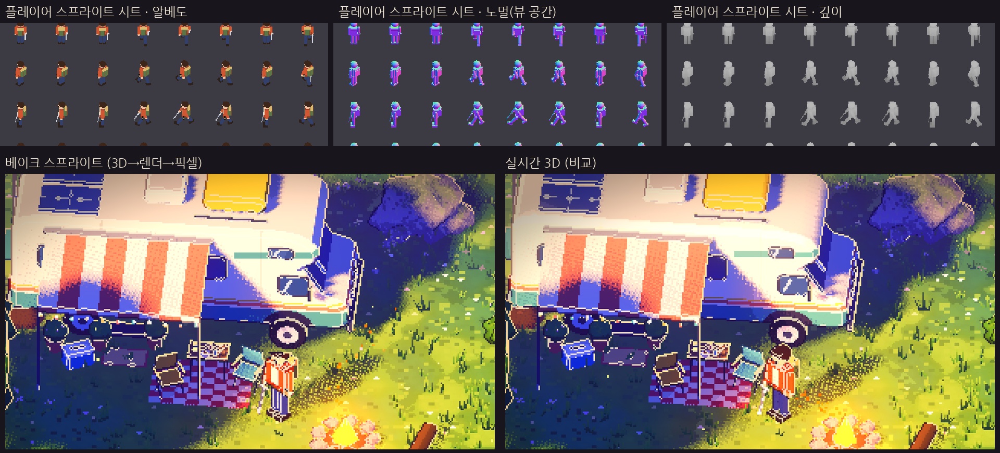

# 3D 모델 → 렌더 → 픽셀 스프라이트 파이프라인 (데드셀 방식)

> 캐릭터·몬스터·캠핑카를 실시간 3D로 그리지 않고, **3D 모델을 고정 카메라로 렌더해 픽셀 스프라이트 시트로 구운 뒤**
> 게임에서 그 스프라이트를 그립니다. 데드셀이 쓰는 방식과 같은 구조입니다(3D 모델 → 렌더 → 픽셀 + 노멀맵으로 동적 조명).
> 검증 환경: Godot 4.7.2, 소프트웨어 렌더러(실제 GPU 미검증).



## 실행

기본으로 켜져 있습니다. **`Z`** 로 "베이크 스프라이트 ↔ 실시간 3D"를 바꿔 비교할 수 있습니다.
캡처·시트 재생성: `Godot --path . -- --tour=sprites --capture-dir=<폴더>` (시트는 `<폴더>/sheets/`에 PNG로 저장)

## 구조

```
PlayerRig / SlimeRig / CamperExterior   (3D 모델 = 원본, 포즈 함수 보유)
        │  SpriteBaker  (별도 SubViewport, 자체 World3D, AA 없음, 게임과 같은 피치·텍셀 크기)
        ▼
  아틀라스 4종: 알베도(sRGB) · 노멀(뷰 공간, float) · 깊이(앵커 평면 기준 m, float) · 발광(변형별)
        ▼
  BakedSprite  (카메라를 향한 판, 텍셀 격자에 스냅)
     - 알베도 + 노멀 → 실시간 셀 라이팅 (햇빛·달빛·등불·모닥불·헤드라이트)
     - 깊이 → DEPTH 기록 = 소품·나무와 정확한 앞뒤 관계, 외곽선 패스도 그대로 동작
     - LIGHT_VERTEX = 복원한 표면 위치 → 그림자/광원 계산이 실제 형태 기준
  원본 3D 모델은 "그림자 전용"으로 남김 → 애니메이션 그림자가 그대로 생김
```

| 대상 | 시트 | 셀 크기(m) | 비고 |
|---|---|---|---|
| 플레이어 | 15열(대기 2 · 걷기 8 · 공격 5) × 8방향 | 2.7 × 2.7 | 등불 발광 맵은 등불 ON일 때만 사용 |
| 슬라임 | 8열(점프 주기) × 8방향 | 1.6 × 1.8 | 점프 높이·찌그러짐까지 프레임에 포함 |
| 캠핑카 | 1 × 1 | 10.5 × 8.5 | 발광 맵 2종(라이트 OFF/ON, F 키에 따라 교체) |

- **한 번에 굽기:** 모든 프레임·방향의 인스턴스를 격자로 늘어놓고 패스마다 한 번씩만 렌더합니다(대상당 5~6프레임).
  소프트웨어 렌더러에서 세 대상 합계 약 4~10초 걸렸고, 실제 GPU에서는 훨씬 짧을 것으로 예상합니다(미측정).
- **자동 재베이크:** 카메라 스타일(피치), 줌, 해상도 프리셋이 바뀌면 텍셀 크기가 달라지므로 자동으로 다시 굽습니다.
  굽는 동안에는 이전 시트가 계속 보입니다. 원근 투영(`C`)에서는 실시간 3D로 돌아갑니다.
- **픽셀 정렬:** 카메라와 스프라이트가 같은 텍셀 격자에 스냅되어, 스프라이트 픽셀이 화면 텍셀과 1:1로 맞습니다
  (이동 중 캐릭터 윤곽이 텍셀 사이에서 흔들리지 않음).
- **조명:** 카드 셰이더는 랩 없는 하드 셀 라이팅(custom `light()`)을 씁니다. 표면 뒤쪽 광원이 새지 않습니다.

## 실시간 3D와 비교 (`captures/sprite_pipeline/`)

| 장면 | 파일 | 관찰 |
|---|---|---|
| 낮 근접 | `sprite_closeup_baked/live3d.png` | 거의 동일. 스프라이트는 8방향으로 양자화되고 픽셀 경계가 더 또렷함 |
| 낮 전경 | `sprite_day_*.png` | 동일 수준 |
| 밤 | `sprite_night_*.png` | 베이크 쪽이 더 깨끗함: 실시간 3D는 툰 랩 때문에 차양 아래 현관등 빛이 위로 새어 얼룩이 생김 |
| 슬라임 | `sprite_slime_*.png` | 점프 프레임 8장으로도 자연스러움 |
| 실내 | `sprite_interior_*.png` | 동일 |

## 이 방식의 장점 (P1 이후)

- 시트가 PNG로 나오므로 **픽셀 아티스트가 프레임을 직접 손볼 수 있습니다**(데드셀 워크플로). 손본 PNG를 불러오는
  단계는 아직 없습니다. 현재는 실행할 때마다 다시 굽습니다.
- 캐릭터 수가 늘어도 화면에는 판 하나씩만 그리므로 비용이 일정합니다(그림자 전용 원본 모델은 별도 비용).
- 애니메이션을 프레임 단위로 끊어 "픽셀 애니메이션" 느낌을 낼 수 있습니다(현재 걷기 8프레임, 공격 5프레임).

## 한계 / 남은 일

1. 방향이 8방향으로 끊깁니다. 대각선 이동 중 회전이 계단식으로 보입니다(의도된 픽셀풍이지만 확인 필요).
2. 판 위의 그림자·광원 계산은 복원한 표면 기준이지만, 얇은 부분(검, 차양 끝)은 깊이 해상도 한계로 약간 어긋날 수 있습니다.
3. 깊이를 기록하는 셰이더라 early-z가 꺼집니다. 스프라이트가 많아지면 비용을 확인해야 합니다.
4. 베이크 결과를 파일로 고정하고 수정본을 다시 불러오는 "에셋화" 단계는 아직 없습니다.
5. 나무·풀·소품은 여전히 실시간 3D입니다. 정적 소품도 같은 방식으로 구울 수 있지만, 지금은 캐릭터·몬스터·캠핑카만 적용했습니다.
