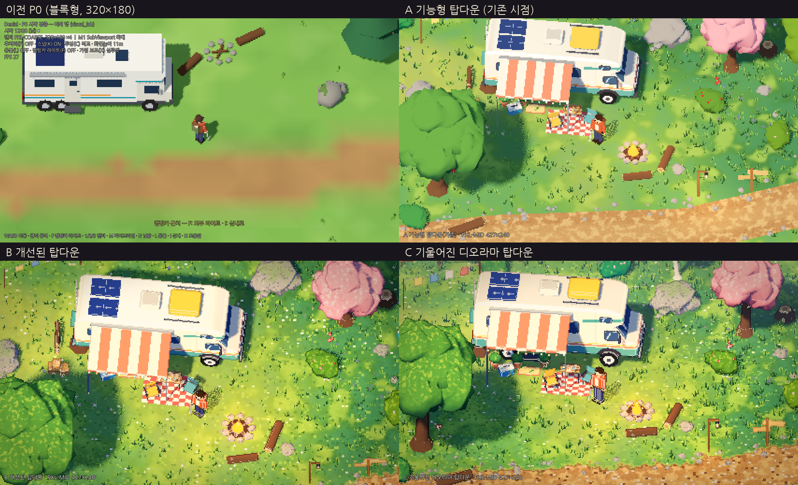
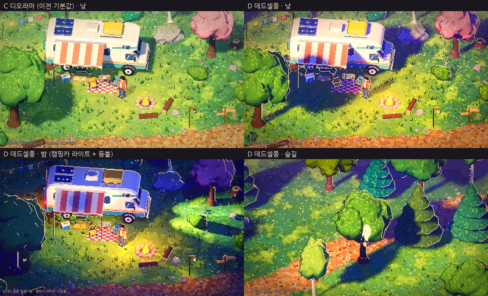

# 비주얼 방향 수정 — 디오라마형 3D 픽셀풍 (카메라 A/B/C/D 비교)

> 목표: "블록형 저해상도 테스트맵(Minecraft-like)"에서 벗어나 **풍부한 디오라마형 3D 픽셀풍**으로 갈 수 있는지 검증.
> 대상: 야외 캠핑카 씬, 낮 기준. 검증 환경은 이전과 같습니다(Godot 4.7.2, 소프트웨어 렌더러 llvmpipe, **실제 GPU 미검증**).

## 갱신: D = 단색 셀 채색 (현재 기본값)

사용자 피드백("너무 디테일함, 단색에 명암만, 반짝이 줄이기")에 따라 D를 다시 조정했습니다. 최신 화면은 `captures/hd_1080p/`.

- **단색 + 2단 명암:** 모든 재질을 랩 없는 셀 라이팅(빛/그림자 2단)으로 바꿨습니다. 지형·나뭇잎·바위·풀의 붓터치, 반점, 꽃 반점, 잎 뭉치 무늬는 끔(`detail = 0`). 지면은 잔디 2톤 + 흙 + 모래만 남김.
- **명도 계단(luma bands)과 SSAO 끔:** 셀 명암만으로 입체를 표현합니다.
- **그림자:** 부드러운 반그림자가 픽셀화하면 점묘처럼 지글거려서, 경계가 딱 떨어지는 그림자로 바꿈. 나뭇잎은 그림자를 받지 않음(덩어리끼리의 그림자가 빗금처럼 보였음). 땅에는 그대로 드리움.
- **반짝이 감소:** 떠다니는 입자 90→18개(밝기 절반), 모닥불 불씨 26→12개, 블룸 약화, 줄전구 발광 절반, 꽃 군락 숨김, 풀 다발 8,400→3,700개, 자갈 700→250개.
- **외곽선:** 기본 ON — 물체 실루엣에만 1픽셀 짙은 선(림라이트·모서리 하이라이트 없음). 지면은 외곽선 없음. `O`로 끔.
- **카메라:** D의 화면 세로 10m → 13m로 줌 아웃(사용자 요청). `-`/`=`로 조절 가능.
- **밤 캐릭터 명암:** 허리 등불이 몸 안쪽에 있어 스프라이트에 밝은 점이 흩뿌려지던 문제 → 플레이어 스프라이트는 자기 등불의 영향을 받지 않음(주변은 계속 비춤).
- **나무 도트 느낌:** 잎 덩어리에만 어두운 윤곽선(외곽선 패스의 "잎 전용" 모드, 러프니스 0.91 태그로 판별)과 3톤 셀 명암(그림자/중간/빛). 전체 외곽선은 여전히 OFF.
- **주인공:** 콘셉트 이미지 기반 → 사용자 수정 반영(대머리, 가방 제거). 통통한 체형, 굵은 눈썹·콧수염·수염 자국·붉은 코, 흰 나시티(민소매, 사용자 수정), 짧고 귀여운 다리, 나침반 목걸이, 카키 카고 반바지, 샌들, 손목시계. 무기는 없음(공격 모션은 팔 휘두르기 임시).

## 이전: D 데드셀풍 픽셀 (첫 버전)

데드셀(Dead Cells)의 화면 특징을 탑다운 3D 픽셀 렌더에 옮긴 스타일입니다. 카메라는 C와 같고(40°, 10m) 표현만 다릅니다.

| 데드셀 특징 | D에서의 구현 |
|---|---|
| 끊어지는 셀 명암 | 툰 셰이딩 + 색보정 단계에서 밝기를 7단계로 양자화(색상은 유지, 명도만 계단) |
| 보라/남색 그림자 vs 주황·분홍 하이라이트 | 보라빛 환경광, 따뜻한 낮은 각도의 햇빛, 어두운 영역을 보라(0.16, 0.09, 0.28) 쪽으로 밀기, 스플릿 토닝 |
| 아주 어두운 외곽선 + 밝은 림라이트 | 외곽선 패스에서 실루엣 텍셀 중 오른쪽·위를 향한 면은 밝은 림(1.0, 0.82, 0.62), 나머지는 짙은 보라 외곽선 |
| 강한 채도·대비 | 채도 1.22, 대비 1.12, 비네트 강화 |
| 발광체 블룸 | glow 문턱값을 낮추고(0.9) 강도를 올림, 모닥불·줄전구 발광 강화 |
| 떠다니는 불씨·먼지 | 모닥불 불씨 파티클, 플레이어 주변 반딧불/먼지 파티클(1텍셀 크기) |
| 보라빛 원경 | 분홍·보라 깊이 안개 |

**판단:** 밤 장면(`style_D_night_PXL-MID.png`)에서 데드셀 느낌이 가장 강합니다. 어두운 보라 배경 위에 모닥불·헤드라이트·줄전구가 빛나고 림라이트가 실루엣을 잡아 줍니다.
낮 장면은 C보다 극적이지만, 햇빛이 주황으로 치우치면 잔디가 탁해집니다. 그래서 키 라이트를 연한 살구색으로 조정했습니다.

**한계:** 림라이트 방향이 화면 기준으로 고정되어 있습니다(실제 광원 방향과 무관). 큰 수관에서는 림이 윤곽을 따라 길게 그려져 선화처럼 보일 수 있습니다.
명도 양자화는 저해상도에서 그라데이션을 계단처럼 만들어 의도한 효과를 내지만, 지형 노이즈와 겹치면 얼룩처럼 보이는 구간도 있습니다. 데드셀 원작의 손으로 그린 노멀맵·캐릭터 애니메이션 품질은 이 프로토타입 범위 밖입니다.

## 실행

F5 → 야외 씬. **`V`로 A → B → C → D 전환**(시작은 D), `O` 외곽선 ON/OFF, `1~4` 해상도(기본 **PXL-MID 427×240 ×3**).
비교 캡처 재생성: `Godot --path . -- --tour=styles --capture-dir=<폴더>`

## 무엇을 바꿨나 (모든 버전 공통 — 씬 자체)

| 영역 | 이전 | 지금 |
|---|---|---|
| 지형 | 정점 색 단색면, 흙길 = 갈색 띠 | 핸드페인팅풍 지형 셰이더: 3~5색 잔디 패치, 붓터치 반점, 픽셀 크기 꽃, 노이즈로 일그러진 흙길 경계, 자갈·어두운 테두리·밝은 중앙, 모래 물가 |
| 풀·꽃 | 원뿔 몇 개 | MultiMesh 풀 다발 약 8,400개(바람 흔들림), 패치형 꽃 군락, 길가 자갈 700개 |
| 나무·덤불 | 구/원뿔 프리미티브 | 노이즈로 변형한 유기적 덩어리 + 잎 셰이더(트라이플래너 잎 뭉치 하이라이트, 밑면 어둡게, 나무마다 색조 변화). 활엽수·침엽수·자작나무·**벚꽃나무** |
| 바위 | 구 2개 | 울퉁불퉁한 덩어리 + 바위 셰이더(밝은 띠, 반점, 윗면 이끼) |
| 캠핑카 | 박스 조합 | 둥근 측면 실루엣을 압출 + 모서리 베벨, 투톤 도색 셰이더(크림/청록 하단/코랄·머스터드 줄, 알코브 스우시, 휠 아치), 둥근 창문 + 반사광, 문·발판·매트, 크롬 휠, 그릴·범퍼, 루프 카고박스·태양광 패널·에어컨, 스페어 휠 커버, **줄무늬 차양 + 줄전구** |
| 캠프 소품 | 모닥불 돌 | 체크무늬 피크닉 러그, 캠핑 의자 2, 접이식 테이블(랜턴·머그·빵·과일), 아이스박스, 화분 3, 실제로 타오르는 모닥불(깜빡이는 광원), 통나무 의자, 장작더미 + 도끼 꽂힌 그루터기, 나무 상자, 빨랫줄, 랜턴 기둥, 이정표, 버섯, 그루터기 |
| 배치 | 무작위 분산 | 디오라마 구도: 왼쪽 앞 큰 그늘 나무, 오른쪽 뒤 벚꽃나무, 캠핑카 뒤 침엽수 배경, 캠프 가장자리를 감싸는 덤불·바위 |
| 셰이딩 | 기본 램버트 | **툰 디퓨즈**(명암 경계가 또렷 → 픽셀화 후 손으로 칠한 명암처럼 보임) |

## 카메라/렌더 버전별 차이

| | A 기능형 탑다운(기존) | B 개선된 탑다운 | C 기울어진 디오라마 탑다운 |
|---|---|---|---|
| 피치(지면 기준) | 50° (이전 P0와 동일) | 62° (더 위에서) | 40° (앞면이 보임, 아이소메트릭보다는 위) |
| 화면 세로 | 11m | 10m | 10m |
| 구도 | 플레이어 정중앙 | 시선을 1.6m 북쪽으로 → 캠핑카가 위, 인물이 아래 1/3 | 시선 1.0m 북쪽 |
| 픽셀 외곽선 (깊이/노멀 엣지) | 없음 | 있음 | 있음 |
| 색보정 (스플릿 토닝·비네트·채도) | 없음 | 있음 | 있음 |
| SSAO | 없음 | 있음 | 있음 |
| 깊이 안개(원근감) | 없음 | 없음 | 있음 |
| 지형 붓터치·꽃 반점 | 꺼짐(평탄) | 켜짐 | 켜짐 |

A는 "새 에셋 + 이전 카메라·렌더 설정"입니다. 진짜 이전 화면은 요약 이미지 왼쪽 위에 함께 넣었습니다.

## 판단

**C(기울어진 디오라마 탑다운)가 목표 스타일에 가장 가깝습니다.**

- 캠핑카의 측면(도색·창문·차양·줄전구)과 인물의 얼굴·옷이 보여 "캠핑카가 집"이라는 느낌이 가장 강합니다.
- 나무 줄기·바위 옆면·모닥불 높이가 보여 장면이 상자 속 미니어처(디오라마)처럼 읽힙니다.
- 깊이 안개와 큰 그늘 나무의 앞뒤 관계로 원근감이 생깁니다.
- B는 위치 판독(전투)에는 가장 명확하지만 지붕 면적이 화면을 지배해 캠핑카가 "흰 판"처럼 보이고, 감성은 C보다 약합니다.
- A는 에셋이 좋아져도 외곽선·색보정이 없어 "3D를 낮은 해상도로 찍은 화면" 느낌이 남습니다. → **외곽선 + 툰 셰이딩 + 색보정이 "의도된 픽셀풍"을 만드는 핵심**이라는 것을 확인했습니다.
- 해상도는 **PXL-MID(427×240)** 를 권장합니다. COARSE(320×180)는 소품이 뭉개지고, SOFT(640×360)는 픽셀풍이 약해집니다(`style_C_PXL-COARSE.png`, `style_C_PXL-SOFT.png`).

**권장 조합(제안, 확정 아님):** C 카메라 + PXL-MID + 픽셀 외곽선 + 툰 셰이딩 + 약한 색보정.

## 남은 한계

1. **풀 다발이 여전히 다소 바쁩니다.** 화면 전체에 같은 밀도의 짧은 획이 깔려 일부 구간은 "털"처럼 보입니다. 군락 대비(빈 곳/빽빽한 곳)를 더 키우거나 다발 모양을 정리해야 합니다.
2. **잎 덩어리 경계에 가끔 밝은 이음선**이 보입니다(덩어리끼리 교차하는 곳). 외곽선 패스의 오검출은 고쳤지만 조명 쪽 원인이 남아 있습니다.
3. **C 시점에서는 나무가 인물을 가리는 빈도가 높아집니다.** 실루엣으로 보완되지만 큰 수관은 디더 투명화(`X`)를 병행하는 편이 좋습니다.
4. 캐릭터는 아직 박스형 임시 인형입니다. 캠핑카·환경보다 정보량이 적어 상대적으로 투박해 보입니다(이번 범위 밖).
5. 외곽선 패스는 **Forward+ 전용**입니다. Compatibility 렌더러에서는 자동으로 꺼집니다.
6. 바람에 흔들리는 풀은 픽셀이 계속 바뀌므로, 실기에서 "살아 있음"과 "반짝임" 중 어느 쪽으로 느껴지는지 확인이 필요합니다.
7. 소프트웨어 렌더러에서 8~13fps. 실제 GPU 성능(MultiMesh 약 8,400개, SSAO, 그림자, 외곽선)은 측정하지 못했습니다.

## 캡처 목록 (`captures/visual_direction/`)

| 파일 | 내용 |
|---|---|
| `00_summary_before_A_B_C.png` | 이전 P0 / A / B / C 4분할 요약 |
| `style_A_PXL-MID.png` / `style_B_PXL-MID.png` / `style_C_PXL-MID.png` | 같은 위치·시각(10:30)에서 A/B/C |
| `style_C_PXL-COARSE.png`, `style_C_PXL-SOFT.png` | C를 다른 해상도로 |
| `style_B_forest_occlusion.png`, `style_C_forest_occlusion.png` | 숲길, 나무 뒤 인물 실루엣 |
| `style_C_path_slime.png` | 흙길 경계·자갈·슬라임 |

이전 P0 테스트 장면(밤·실내·렌더 모드 비교)은 새 아트로 다시 찍어 `captures/p0_baseline/`에 있습니다.
